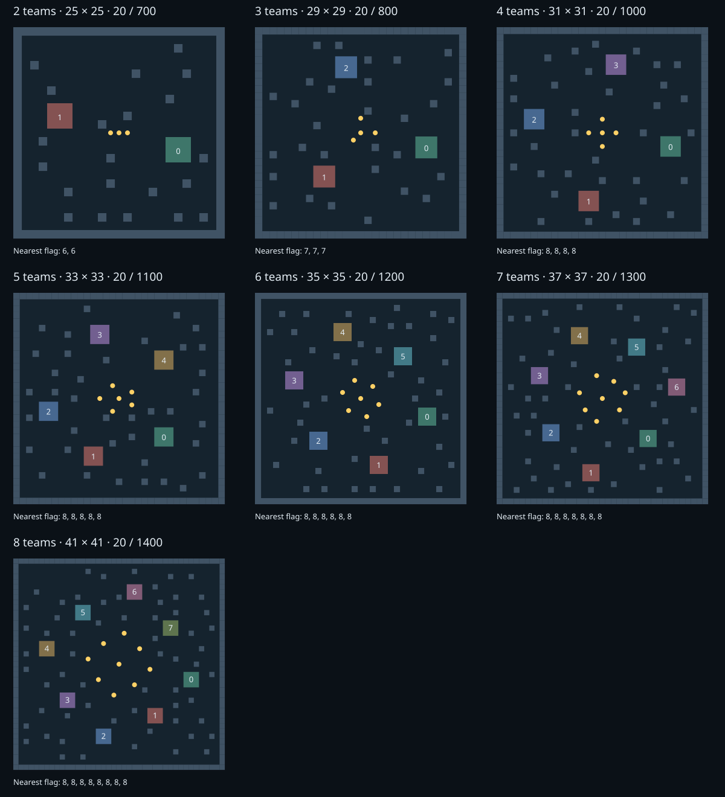

# 首回合预算与地图 v3 实测

用户确认：第 1 回合整队 250ms，其余回合 50ms；出生区到旗点拉远。地图尺寸、出生区、旗点数量和 20 分目标保留。新版旗点向中心收拢，稀疏掩体重建。



## 几何与终局标定

| 队伍数 | 最近旗点（各槽相同） | v2 距离 | 试跑回合 min / median / max | 正式上限 | 独立种子 1231 / 2027 |
| --- | --- | --- | --- | --- | --- |
| 2 | 6 | 3 | 439 / 451 / 511 | 700 | 405 / 382 |
| 3 | 7 | 4 | 244 / 294 / 326 | 800 | 237 / 244 |
| 4 | 8 | 4 | 472 / 511 / 716 | 1000 | 516 / 581 |
| 5 | 8 | 4 | 242 / 354 / 417 | 1100 | 279 / 301 |
| 6 | 8 | 4 | 252 / 301 / 329 | 1200 | 348 / 287 |
| 7 | 8 | 4 | 238 / 304 / 400 | 1300 | 254 / 310 |
| 8 | 8 | 4 | 283 / 308 / 341 | 1400 | 312 / 312 |

出生区九格作为正交 BFS 多源起点。七图最近旗点槽间差为 0，到所有旗点平均距离的最大槽间差为 1 步。旗点唯一、不在出生区内；封边、出生区合法性、地面全连通由正式加载器与回归测试检查。

试跑使用 release 裁判、公开 C ABI 基准 AI，每图种子 7/41/97/211/509、AI seed=1000+team_id，临时上限 3000，共 35 场。全部达到 20 分并通过 Rust verify，无 AI 故障或截尾。按 `max(400, 前一人数上限+100, ceil(最慢回合×1.35/100)×100)` 确定上限。随后按正式上限用两个独立种子运行 14 场，全部达标并验证，无截尾或 AI 故障；验证集只检验上限，不用其较低建议回调正式值。

## 动态掉旗与标定分类

试跑发现两次 `carrying_cannot_enter_flag`：4p seed=97 第 239 回合，以及 5p seed=41 的一次。目标格在 START 没有地上旗，同轮射击死亡掉旗后才禁止携旗者进入。这是开始观测无法预见的动态结果，原始 summary 的非法计数保留。旧标定器因此停止，查明原因后从相同种子续跑，没有更换或丢弃样本。

独立种子验证中另有 0 次此类事件。标定器只在完整 Rust verify 后单独统计这些事件，仍拒绝可预见的非法提交、其他非法动作、全部 AI 故障及计数不一致；新分类有正反例单测。

## 位置偏好和解释边界

| 队伍数 | 五场基准自战每槽平均分（team_id 顺序） |
| --- | --- |
| 2 | 20.0, 17.4 |
| 3 | 20.0, 6.4, 5.6 |
| 4 | 14.8, 19.8, 12.8, 14.4 |
| 5 | 9.0, 7.8, 1.0, 20.0, 5.6 |
| 6 | 0.8, 20.0, 4.8, 1.8, 14.8, 4.6 |
| 7 | 8.0, 19.8, 4.0, 2.6, 14.2, 11.4, 1.0 |
| 8 | 2.0, 13.2, 18.2, 3.8, 2.4, 14.0, 17.0, 3.0 |

集中争夺后，基准自战的槽位差异仍很大，部分人数比 v2 更明显。基准策略的固定选路/破平方式与混战均可能贡献差异，等距不能证明同胜率。新版实现的是更长的最近取旗距离，不能由这些样本声称所有强算法的优势扩大或地图实战公平性提高。正式比赛必须轮换位置并跑多个种子。

用户提供的外部 `~/Program/not-allowed/eval/runs/tournament/report.md` 标记已验证 990/990 场；Team 1 在 2–8 人各名单均第一，多队出生位成绩仍有明显差异。另只读参考了 `~/Program/workspace/contest/fff-contest/docs/submission.md` 和 `src/team.cpp`：采用按需路径缓存、任务分配与战斗推演。这些旧图结果仅作为背景，不与新版少量自战合并，也没有为该 AI 的输赢选择地图。原目录未修改。

## 原始证据与重现

本地原始数据保留在 `runs/arena-v3/pilot/` 和 `runs/arena-v3/final/`；每场完整 JSON/ASCII、实际 RON、summary、manifest 和环境/二进制/地图 SHA-256 均保留。初次停止日志为 `pilot.log`，续跑为 `pilot-resume.log`，独立验证为 `final.log`。

| 阶段 | 源提交基线 | runner SHA-256 | 基准 SHA-256 |
| --- | --- | --- | --- |
| 试跑 | `9b0208b` | `ce93cd5638e61769612d6cc677164f67fd0238493a52cf37d3aef830e2302d31` | `172c430148e83cd28ec2ce955f4f60a3cf0ba5a48191c8302fe3e8d405a9692b` |
| 独立验证 | `9b0208b` | `644e18f4bcb9231eecc438045cc3c777f4661582a09383599046ab506fa07137` | `172c430148e83cd28ec2ce955f4f60a3cf0ba5a48191c8302fe3e8d405a9692b` |

环境：Intel(R) Core(TM) Ultra X7 358H；Linux-6.18.55-1-lts-x86_64-with-glibc2.44；release。源提交是分支基线，地图及计时/验证代码为当时的候选变更，重现应以记录中的实际二进制和地图哈希为准。试跑结束后补齐了新旧计时策略验证，独立验证使用更新后的 runner；基准与引擎玩法不变。

```sh
cargo build --release --workspace
python3 scripts/generate_maps.py --check
python3 scripts/calibrate_maps.py --out runs/v3-pilot-new --pilot-max-turns 3000
python3 scripts/calibrate_maps.py --out runs/v3-final-new --seeds 1231 2027
```

## 计时与交付验收

真实 C 动态库：100ms 首回合输出被采用，后续 100ms 超时整队等待；首回合 350ms 超时，重启后不重获 250ms，快速下一轮恢复。完整 CLI 比赛使用真实 100ms 首回合并经过记录/verify；回放单测检查首轮/常规阈值边界、旧版 50ms 策略与未知策略拒绝。旧版 `runs/main-v1/2p` 验证通过；runner 退出时暂停/活动 worker 及普通 fork 辅助进程清理通过。

最终题包与独立审查证据在完成后补记于本文及审查记录。
