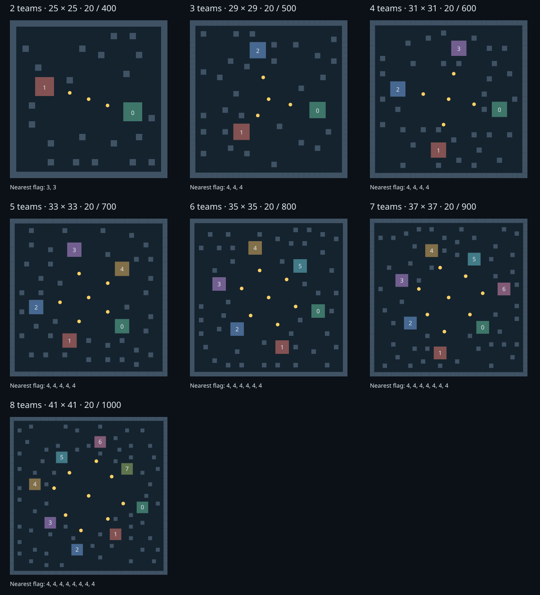

# 地图 v2 与 20 分终局标定

历史报告：对应地图 v2。当前默认地图已改为 v3，参见 [新版标定](arena-v3-2026-10-15.md)；本报告的原始结论和概览保留。

地图文件仍为 RON v1，地图布局版本称为 v2；玩法、引擎和基准策略未改。目标分统一 20；每回合完整结算后判断，允许同轮超过 20 或并列。

## 参考与布局

只提取用户提供的六份本地 HTML 内嵌 JSON，不执行其中脚本。参考地图采用曼哈顿等距出生环和稀疏掩体，最近旗点距离差在 0–1 步；其射程 2、100 HP/34 伤害、旗帜周期等与本项目不同，未沿用其数值，也未扩展到 12/15 队。

| 参考文件 | 尺寸 | 内部障碍格 | 最近旗点距离最小–最大 |
| --- | --- | --- | --- |
| /tmp/2p-astra-vs-baseline.html | 23 | 14 | 3–3 |
| /tmp/3p-melee.html | 31 | 39 | 5–6 |
| /tmp/5p-melee.html | 31 | 31 | 5–5 |
| /tmp/8p-melee.html | 41 | 64 | 8–8 |
| /tmp/12p-melee.html | 49 | 106 | 11–11 |
| /tmp/15p-melee.html | 49 | 102 | 11–12 |

新图移除四向开口的中央墙环，出生区沿菱形等曼哈顿半径分布，每队朝中心方向放一个近旗点，另有中央旗点。近旗点都是中立资源，没有队伍所有权。固定整数方位与固定种子约 4% 独立单格掩体可通过生成器重现；不在比赛运行时随机生成。增加障碍前后，各出生区到各旗点的最短距离矩阵保持相同，全地面连通。

首轮 35 场发现仅消除距离差仍不够，内圈旗点易受邻队争抢/拦截。第二轮将旗点向出生区外移，保留中央争夺点，使用同样 35 个对局输入复测。最终采用第二轮布局。



## 标定方法

环境：Intel(R) Core(TM) Ultra X7 358H；Linux-6.18.55-1-lts-x86_64-with-glibc2.44；release。引擎/AI 源提交基线 `e494610`，地图为本次未提交候选资产；实际地图及二进制 SHA-256 保存在各阶段 report.json 与比赛 manifest 中，不能仅凭 Git HEAD 重现候选布局。

每图五个引擎种子 `7,41,97,211,509`，所有槽位加载同一个基准 cdylib，AI seed 明确为 `1000+team_id`。各队通过正式 C ABI/串行 worker/50ms 预算；每场完整记录并 Rust verify。标定地图临时上限为 3000，目标 20；最终 RON 上限另行设置。所有标定场均因达标结束，没有截尾样本、AI 故障或非法动作。

上限公式：`max(400, 前一种人数上限+100, 向上取百(1.35×本人数最慢标定结束回合))`。使用最长实测而非平均值留余量；递增下限体现用户偏好。若存在 max_turns 截尾，不按正常完成耗时计算，脚本拒绝自动建议。样本仅覆盖该基准，不能保证任意强弱 AI 都在上限内达 20 分。

| 队伍数 | 最终尺寸 | 最短取旗距离（所有槽相同） | 内部障碍 | 标定结束回合 min / median / max | 上限 |
| --- | --- | --- | --- | --- | --- |
| 2 | 25×25 | 3 | 21 | 230 / 243 / 278 | 400 |
| 3 | 29×29 | 4 | 29 | 255 / 288 / 293 | 500 |
| 4 | 31×31 | 4 | 34 | 292 / 313 / 333 | 600 |
| 5 | 33×33 | 4 | 38 | 209 / 317 / 342 | 700 |
| 6 | 35×35 | 4 | 44 | 230 / 263 / 330 | 800 |
| 7 | 37×37 | 4 | 49 | 283 / 286 / 335 | 900 |
| 8 | 41×41 | 4 | 61 | 279 / 304 / 358 | 1000 |

## 位置偏好与限制

下表为每槽五场平均分，按 team_id 排列。相同策略不需要交换身份；这些数据用于暴露位置差异，不等价于不同 AI 已完成轮换评测。两个阶段相同种子，但布局变化可能改变 RNG 消耗和后续战况，不能将每个事件一一配对解释。

| 队伍数 | 首轮内圈方案平均分 | 最终外移方案平均分 |
| --- | --- | --- |
| 2 | 18.6, 18.8 | 18.6, 18.8 |
| 3 | 20.0, 9.4, 13.6 | 19.8, 14.0, 17.0 |
| 4 | 15.6, 18.8, 14.6, 17.4 | 17.4, 18.4, 17.6, 19.4 |
| 5 | 11.6, 10.2, 5.6, 20.0, 9.0 | 14.6, 12.2, 12.2, 20.0, 13.0 |
| 6 | 4.6, 18.8, 13.8, 3.2, 18.8, 11.6 | 6.0, 18.4, 11.8, 6.6, 16.2, 11.4 |
| 7 | 10.0, 17.6, 5.6, 2.6, 18.0, 15.8, 2.8 | 14.2, 20.0, 9.0, 9.6, 16.0, 13.2, 6.6 |
| 8 | 2.0, 13.2, 18.2, 3.8, 2.4, 14.0, 17.0, 3.0 | 8.2, 18.0, 17.6, 10.0, 5.6, 16.0, 18.0, 11.4 |

最终图七种人数的最近旗点距离差均为 0；到所有旗点的平均距离最大槽间差为 2.25 步（七队）。几何公平不等于策略胜率公平：6–8 队仍有明显位置偏好，不能声称每槽同等胜率。基准本身没有风险模型且破平次序固定，当前数据不足以把差异完全归因于地图。按用户计划，正式比较不同 AI 时应轮换全部出生槽、固定多个种子。首版旧报告与原回放保留，不能将旧胜率直接用于新地图。

## 重现

```sh
python3 scripts/generate_maps.py --check
python3 scripts/calibrate_maps.py --out runs/map-pilot-new --pilot-max-turns 3000
python3 scripts/calibrate_maps.py --out runs/map-final-new --seeds 1231 2027
```

原始数据：`runs/map-balance/pilot/`（首轮）、`pilot-v2/`（选定布局标定）、`final/`（最终上限、独立种子）。各目录含可验证完整记录、实际 RON、报告和环境/种子/哈希。中断后可加 `--resume`，复用前先核对输入并重新 verify；不覆盖未完成比赛。

## 独立种子验证

最终 RON 使用正式上限，以未参与标定的 `1231,2027` 两个引擎种子逐图验证。14 场全部达到 20 分，全部 replay verify 通过，无 AI 故障/非法动作。

| 队伍数 | 1231 / 2027 结束回合 | 正式上限 |
| --- | --- | --- |
| 2 | 262 / 266 | 400 |
| 3 | 252 / 239 | 500 |
| 4 | 280 / 307 | 600 |
| 5 | 347 / 307 | 700 |
| 6 | 303 / 309 | 800 |
| 7 | 274 / 313 | 900 |
| 8 | 298 / 275 | 1000 |
